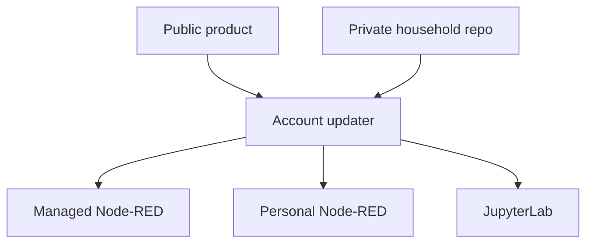

# Boflow

**Shared household automation. Personal tools on each account.**

[](https://github.com/tbrandenburg/boflow/actions/workflows/check.yml)
[](/LICENSE)

Boflow installs and updates **Node-RED, JupyterLab, and CLI tools** for individual
accounts on Ubuntu and macOS. Keep shared flows and pinned dependencies in one
**private household GitHub repository**; each account keeps its own work and secrets.
Updates run at graphical login or on demand, without an always-on coordinator.

[Get started](#get-started) · [Daily commands](#daily-commands) ·
[Configuration](#configuration) · [Publish changes](#publish-household-changes) ·
[Operating guide](/AGENTS.md) · [Validation](#development-and-validation)

## What you get

| Tool | Purpose | Preferred loopback port |
| --- | --- | --- |
| Managed Node-RED | Runs published household flows | `11880` |
| Personal Node-RED | Your flows, credentials, and extra palette modules | `11881` |
| JupyterLab | Your notebooks and a managed Python 3.12 environment | `11882` |
| npm / Python CLI tools | Household-selected tools in account-local releases | — |

The initial palette includes Telegram, `@tbrandenburg/node-red-agents`, and
`@flowfuse/node-red-dashboard`. Publish dashboard nodes to create a dashboard;
the starter flow is empty. Provider credentials, bot configuration, and optional
agent CLIs are separate prerequisites.

### How it fits together



Dependencies are prepared before running services are interrupted. Unchanged
healthy services keep running; a shared-flow change restarts managed Node-RED
only. Login updates never run sudo or Homebrew. Application activation recovery
is manual; previous release caches are retained.

## Get started

From the participating account's graphical desktop terminal:

```sh
git clone https://github.com/tbrandenburg/boflow.git
cd boflow
make setup
```

Choose **create** for the administrator's first machine or **join** for another
account. Paste a household GitHub URL or `OWNER/NAME`. The guided setup offers to
install missing uv/uvx and native tools, obtains administrator permission where
necessary, creates the account's read-only deploy key, selects free ports, sets
up login startup, verifies services, and opens your tools. Never run it as root.
On a fresh Mac, Git/make require Apple's Command Line Tools; finish Apple's
installation prompt before cloning. Homebrew's official installer is offered
when needed; an existing Homebrew installation remains under its current owner.

**Create:** the administrator signs in through GitHub CLI's browser/device flow,
confirms a private household repo and local working directory, and approves their
own account key. Missing GitHub CLI is offered through apt/Homebrew. Git identity
is set locally in the household checkout if absent; HTTPS Git authentication is
configured through `gh auth setup-git`. No administrator token is sent to members.

**Join:** no GitHub login is required. Setup prints one PUBLIC `boflow1:` enrollment
request. Share it with the administrator, who runs this from their Boflow checkout:

```sh
make approve
```

Approval uses the checkout's existing `.venv` without bootstrapping or updating
the account launcher. If the environment is missing, it stops with instructions
to run `uv sync --locked` here and retry. Use `make setup` for first-time account
configuration.

The administrator pastes the request and verifies the household, account label,
and public-key fingerprint before approving read-only access. Member setup checks
for access for up to ten minutes and continues when available. Ctrl-C safely
pauses it. Rerun `make setup` to resume; keys, settings, and personal data remain.
Approval can also be repeated without adding duplicate keys. GitHub ties keys
created through CLI authentication to that authorization: revoking it may remove
these keys. Keep the administrator authorization active or register the same
public keys through GitHub's repository settings if changing authentication.

If another Mac account owns Homebrew, already installed packages are reused. When
packages are missing, setup prints the exact `brew install` command for that owner;
rerun setup in the member account afterward. No ownership changes or sudo brew.
Ubuntu missing native packages request explicit installation consent and sudo.
Local setup cannot remove those OS permission/ownership handoffs.

GitHub SSH host keys use accept-new on first access, then remain pinned in local
known_hosts. Preprovision independently verified host keys when required.
Keep the product checkout in place: the installed launcher references its Python
environment. The installed command is `~/.local/share/boflow/bin/boflow`.

`make help` lists everyday commands first: setup, approve, open, status, update.
Diagnostics and maintenance are grouped separately. Low-level bootstrap, enroll,
register, init-home, login, and the redundant uninstall alias are no longer Make targets; their implementation
commands remain available to agents for repair through the installed CLI.

## Daily commands

Run these from the retained product checkout, or use the installed `boflow` CLI.

| Make target | What it does |
| --- | --- |
| `make setup` | Guided create/join installation or resume |
| `make approve` | Administrator approves a member request |
| `make open` | Open the private local tool page |
| `make status` | Show commits, update status, and reachable ports |
| `make update` | Fetch household `main` and apply its pinned product |

Diagnostics (`doctor`, `logs`) and maintenance (`native`, `remove-user`,
`export-managed-flows`, `lock`) are in the separate Make help group.

At graphical login, installed services start before the update check. Offline
login retains the installed services and records the failed check for diagnosis.
There is no periodic updater or OS upgrade job.

## Configuration

| Input | Role |
| --- | --- |
| `BOFLOW_STATE` | Account state location; default `$HOME/.local/share/boflow` |
| `BOFLOW_PORT_BASE` | Advanced low-level registration/test port override |
| `BOFLOW_DIR` | Makefile household working-checkout input |
| `BOFLOW_PYTHON` | Makefile interpreter override; defaults to the local venv if present |

Boflow-owned inputs use `BOFLOW_`. External tools and the OS retain their required
environment names. Set `BOFLOW_STATE` consistently when using a custom installation.

The private repository contains `home.yml`, Node-RED/npm manifests and lockfiles,
Jupyter's `pyproject.toml`/`uv.lock`, and `tools/python-tools.txt`. Use exact direct
versions and a full published product commit SHA. Python is 3.12 in v1. Python CLI
tools pin direct versions; uv resolves their transitive dependencies at install time.
Optional account-local `local.yml` overrides native package lists only.

## Publish household changes

Author shared flows in the maintainer's **personal** Node-RED, then export into
the separate private household working checkout:

```sh
make export-managed-flows BOFLOW_DIR="$HOME/my-household"
# Edit manifests/tool lists as needed, then refresh locks.
make lock BOFLOW_DIR="$HOME/my-household"
```

In that household checkout, review `git diff`, stage named files, commit, and push
`main`. Publish manifests **with** their lockfiles. Members receive the change at
next login or manual update. Test one account before updating the others.

Export strips inline credentials; encrypted credentials remain local. Verify
secret references, required nodes, platform-specific commands, and scheduled
side effects before publishing. Managed-editor changes may be replaced by a
later shared-flow update. See the [publishing guide](/AGENTS.md#5-publish-shared-flows-maintainer).

## Access, backup, and removal

Services bind to `127.0.0.1`. Node-RED is unauthenticated and reachable by other
local accounts: this is a trusted-household setup. The private local page contains
the Jupyter token; do not publish it or paste raw service logs into shared channels.

For remote administration, explicitly enable OS SSH and forward the relevant
account port, for example `ssh -L 11880:127.0.0.1:11880 ACCOUNT@IP`. Remote notebook
or flow editing executes code as that account. No LAN gateway or SSO is provided.

Back up `personal/`, `notebooks/`, managed runtime context, `account.json`,
`secrets.env`, and credential keys separately from Git. Stop services or use a
consistent backup tool. Preserve credential keys to keep stored credentials usable.

`make remove-user` removes services and login startup,
**preserving data, secrets, runtimes, and account state**. The administrator revokes
the deploy key separately. Native packages remain installed. Release-cache cleanup
and bad-release recovery are manual; use the [operating guide](/AGENTS.md#10-diagnose-repair-recover).

## Development and validation

```sh
uv sync --locked
make check
.venv/bin/ansible-playbook --syntax-check -i localhost, ansible/native.yml
make acceptance BOFLOW_PORT_BASE=11880
```

`make check` does not install native packages or startup jobs. `make acceptance`
temporarily installs account services: run it explicitly in a disposable account.
CI checks orchestration and application startup on Linux/macOS. The Ubuntu native
roundtrip has been exercised with real user services: registration, authenticated
application checks, unchanged updates, managed-only restart, offline login, and
uninstall. `make acceptance` uses disposable local Git repositories and removes
its test state; it requires no existing Boflow service files and a working user manager.

Actual logout/reboot, macOS native sessions, simultaneous accounts, GitHub key
authorization, and administrator package consent need separate target-machine
checks. Follow [tests/acceptance.md](/tests/acceptance.md) before unattended deployment.

Contributions should follow [SCOPE.md](/SCOPE.md) and [AGENTS.md](/AGENTS.md).
Open an [issue](https://github.com/tbrandenburg/boflow/issues) for bugs or scope
proposals; keep private configuration and logs out of reports. Extra ideas live
in [BACKLOG.md](/BACKLOG.md).

## License

[MIT](/LICENSE).
